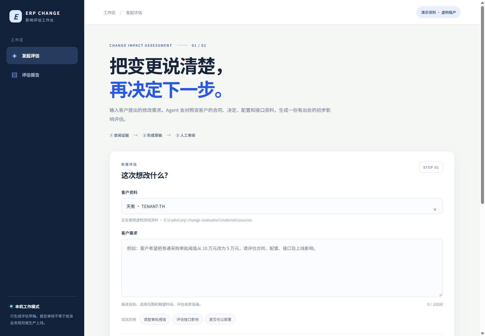

# ERP 变更影响评估 Agent（Python）

客户提出 ERP 流程或规则变更后，这个 Agent 对照该客户的合同、变更单、会议决定、配置快照、工单和接口说明，起草**带原文出处的初步影响评估**。它帮助项目团队回答：现行约定是什么、需求与哪些决定冲突、可能影响哪些配置和接口、还缺什么信息、分别需要谁批准。



## 主要特点

- **模型决定调查步骤**：DeepSeek 根据已读证据选择直接起草，或继续搜索、回读指定段落；LangGraph 保存循环状态、设置调用上限并在人工审阅处暂停。
- **证据可追溯**：报告中的重要结论附文档类型、状态、日期和段落 ID。程序检查引用是否存在、是否属于当前租户与本次证据；另用模型核对原文是否支持结论，无法证实的内容标为“未确认”。
- **短资料直接读全量**：小租户资料直接交给模型；资料增大时再用词项检索和字符相似度挑选段落，并允许按 ID 回读。当前不依赖 embedding API 或向量数据库。
- **权限边界明确**：提供租户隔离、审计、人工确认的项目 Memory、报告审核。本系统只评估和起草，**不批准合同、报价、业务规则或生产上线，也不修改生产 ERP**。
- **可直接试用**：有本机无登录工作台、命令行和带租户令牌的 HTTP API；仓库自带两家虚构租户的 13 份资料和 30 条测试需求。

当前尚未连接真实 ERP，也未用真实客户资料完成准确率评测。`materials/` 全部是虚构测试材料；正式资料应单独导入 `data/`。

## 打开本机前端

在 Windows 上双击项目根目录的 [启动前端.cmd](启动前端.cmd)。脚本会从当前用户桌面的 `api key.txt` 读取 DeepSeek 密钥；若文件不存在，会在终端安全地询问密钥。密钥只进入当前进程环境，不会进入网页、报告或项目文件。浏览器会打开 `http://127.0.0.1:8765/`。

也可以从项目目录运行：

```powershell
.\.venv\Scripts\erp-change.exe ui --ask-api-key
```

前端无需账号登录，可以选择租户、输入需求、查看和下载待审报告、按任务编号重开报告，并记录人工审阅。当前没有正式资料时会明确显示“演示资料”，使用 `materials/sources/` 的虚构租户；导入正式资料后默认使用 `data/sources/`。如需指定资料目录，在 `ui` 前添加 `--sources-root <目录>`。

**无登录模式只绑定本机 `127.0.0.1`。**本机使用者可同时发起和审阅报告，暂不具备按人区分的角色权限；不要将这个工作台通过端口转发或反向代理暴露给其他人。需要多用户和角色控制时，使用下文的令牌 HTTP API，或为前端接入身份认证。报告审阅不授权生产修改。

## 安装

在 PowerShell 中：

```powershell
Set-Location 'E:\Codex\erp-change-evaluation'
python -m venv .venv
.\.venv\Scripts\python.exe -m pip install -e '.[test]'
```

`assess` 需要 DeepSeek API key。可在当前终端设置 `DEEPSEEK_API_KEY`，或加 `--ask-api-key` 交互输入；后者不把密钥写入项目或命令历史。模型默认 `deepseek-flash`，可用 `--model deepseek-v4-pro` 更换。

## 导入真实资料

支持 `.txt`、`.md`、`.docx` 和有可提取文字的 `.pdf`。导入时保留原文件及 SHA256，并生成带租户、状态、日期和段落 ID 的检索文本。扫描版 PDF 需先 OCR 并人工核对。

```powershell
.\.venv\Scripts\erp-change.exe ingest --file 'E:\资料\采购合同.pdf' --tenant CUSTOMER_A --doc-id CONTRACT-001 --type 合同 --status '双方已签署' --date 2026-11-13
.\.venv\Scripts\erp-change.exe ingest --file 'E:\资料\审批会议纪要.docx' --tenant CUSTOMER_A --doc-id MEETING-001 --type 会议 --status '待签收' --date 2026-11-13
```

原件写入 `data/originals/`，可分析文本写入 `data/sources/`。同一文档 ID 不会被覆盖；新版本应使用新 ID，并用 `--supersedes` 指向旧 ID。

## 运行与审阅

```powershell
.\.venv\Scripts\erp-change.exe assess --tenant CUSTOMER_A --ask-api-key --request '请评估采购审批阈值从10万元改为5万元的影响'
.\.venv\Scripts\erp-change.exe show --run-id <上一步显示的ID>
.\.venv\Scripts\erp-change.exe review --run-id <ID> --decision approve --reviewer '审阅人姓名' --note '仅审核报告'
.\.venv\Scripts\erp-change.exe audit --run-id <ID>
.\.venv\Scripts\python.exe -m pytest -q
```

报告写入 `.data/reports/<租户>/`，流程检查点写入 `.data/checkpoints.sqlite`，审计事件写入 `.data/audit.sqlite`。`review approve` **只表示报告审阅通过**，不授权合同、费用或生产修改。

## 本地 HTTP API

使用可信的本地 CLI 分别给分析员、审核员签发绑定租户的 API 令牌。令牌只显示一次，数据库只存摘要；不要把令牌提交到代码库。

```powershell
.\.venv\Scripts\erp-change.exe issue-token --tenant CUSTOMER_A --role analyst --name '分析员'
.\.venv\Scripts\erp-change.exe issue-token --tenant CUSTOMER_A --role reviewer --name '审核员'
.\.venv\Scripts\erp-change.exe serve --host 127.0.0.1 --port 8000
```

API 文档位于 `http://127.0.0.1:8000/docs`。调用时在 `X-ERP-Token` 请求头传令牌。`POST /documents` 导入文件；`POST /assessments` 生成待审报告；`GET /assessments/{run_id}` 读取报告；`POST /assessments/{run_id}/review` 审核；`GET /assessments/{run_id}/audit` 查看审计事件。租户由令牌确定，分析员不能审核报告，跨租户运行号返回 404。服务应仅绑定本机或放在受控网络与 HTTPS 反向代理后。

模型先决定调查动作或起草；起草后程序校验引用 ID、租户和本次证据范围，再用独立模型调用逐条核对原文支持。简单请求通常两次调用，复杂请求可迭代，最多 7 次模型调用、3 次只读工具动作和 45,000 输入 token。无效引用或不支持的结论会反馈修订；仍不支持则明确标为“未确认”，由审阅人核对。预算耗尽且未形成有效报告时失败关闭。

项目记忆通过 `memory-propose`、`memory-review`、`memory-list` 管理。只有人工批准、且引用仍属于当前租户资料的事实才作为辅助上下文提供给模型；原件优先于记忆。旧事实不会被覆盖。

用虚构材料验证模型时，需显式在子命令前加 `--sources-root materials/sources`。例如：

```powershell
.\.venv\Scripts\erp-change.exe --sources-root materials/sources assess --tenant TENANT-XH --ask-api-key --request '请评估采购申请审批阈值改为5万元的影响，并列出待确认事项和审批人'
```

测试答案 `materials/cases/` 不会进入检索。模块与当前边界见 [docs/architecture.md](docs/architecture.md)。
