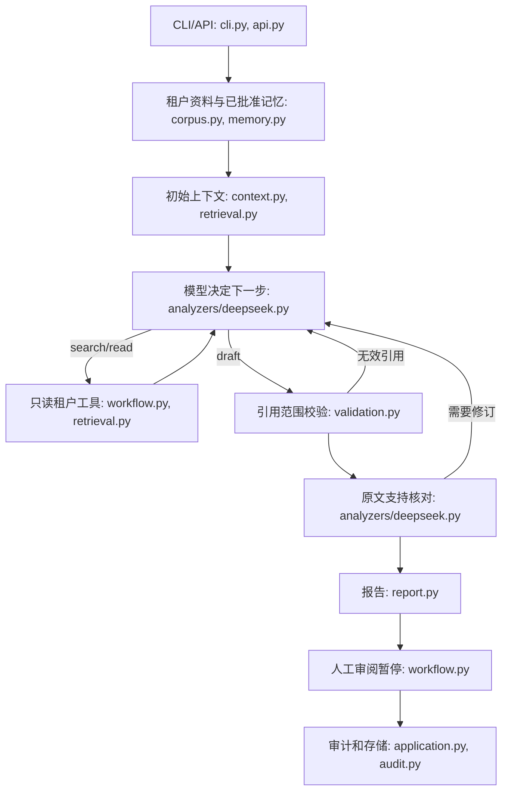

# Agent 架构与边界

`workflow.py` 保留 LangGraph 检查点和人工暂停，但把固定分析节点改为模型决定的调查循环。`analyzers/deepseek.py` 的 `decide` 选择搜索、回读或起草；`check_support` 对照原文逐条复核草稿。模型看不到 ERP 写入、合同批准或生产部署工具。`workflow.py` 对工具参数做租户和段落 ID 校验；搜索仅返回本租户的段落，回读也只接受本租户 ID。资料文本被明示为不可信数据。

小租户的全部原文进入初始上下文。超过 24,000 字或 64 段后，`context.py` 使用 `retrieval.py` 的词项与字符相似度选段，模型可继续搜索和回读。字符相似度不是语义 embedding；将来有 embedding 服务时可替换检索器。证据库保留原件和版本；Memory 只读入人工批准且引用仍有效的事实。

终止条件：模型选择起草，引用范围校验通过，原文支持核对完成。最多 7 次模型请求、3 次工具动作，累计输入 token 上限 45,000，证据上下文不超过 32,000 字。服务端返回不完整结果、非法 JSON、未知段落或预算耗尽时中止并记失败审计，不交付自动通过的报告。语义核对未通过时允许一次修订；仍有疑点的结论标为“未确认”并要求人工核对。

报告含段落 ID、文档类型、状态、日期、来源路径；最终报告在 `.data/reports/<租户>/`。报告审阅由 reviewer/admin 角色完成，仅代表报告审阅。合同、费用、业务规则和生产变更的实际批准应由相应负责人在外部流程完成；本系统没有生产 ERP 连接或部署工具。

本地 SQLite 适合单机试用。正式部署仍需企业身份与权限、密钥托管、并发隔离、资料访问策略、审计保留策略、ERP 只读连接器和真实客户资料的人工准确率评测。虚构租户的测试与单次 DeepSeek 运行不能证明客户场景准确率。
