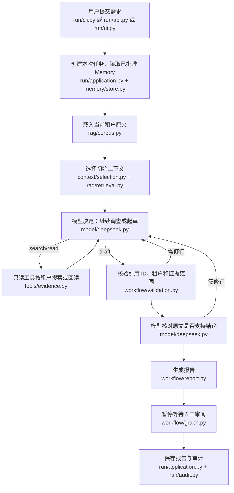

# Agent 代码地图

这次只调整代码位置和导入路径，没有改变评估流程、模型调用策略、API、命令或报告格式。需要按工作时序读代码时，从 `run/` 开始。

```text
src/erp_change_agent/
├─ run/                 运行入口：application.py、cli.py、api.py、ui.py
│  ├─ auth.py           API 令牌与角色
│  ├─ audit.py          审计记录
│  └─ web/              本机前端页面、脚本、样式
├─ workflow/            LangGraph 流程：graph.py、validation.py、report.py
├─ model/               模型接口 base.py；DeepSeek 调用 deepseek.py
├─ tools/               Agent 可调用的只读证据工具 evidence.py
├─ rag/                 原件导入 ingest.py、租户资料 corpus.py、检索 retrieval.py
├─ context/             本轮证据上下文选择 selection.py
├─ memory/              人工审核的项目事实 store.py
└─ schemas.py           各模块共用的数据结构，不是大模型调用
```

## 一次评估怎样走



`workflow/graph.py` 把这些节点串成 LangGraph 循环，并保存证据 ID、已读原文、调查历史、反馈、调用计数和审阅状态。它负责决定何时调用模型或工具，工具本身在 `tools/evidence.py`。`run/application.py` 是一次任务的外层入口：准备资料和 Memory、运行图、保存报告、恢复人工审阅、记录审计。

## 各块负责什么

- `model/deepseek.py` 是唯一调用 DeepSeek API 的业务模块。`decide()` 在已有证据足够时起草，否则选择 `search` 或 `read`；`check_support()` 逐条检查草稿结论及初步判断。`model/base.py` 定义引擎接口，也供测试引擎和审阅恢复使用。
- `tools/evidence.py` 只执行搜索和按段落 ID 回读。每次都从当前租户的资料加载，拒绝未知段落，并受证据字符上限约束。模型没有 ERP 写入、合同批准或生产部署工具。
- `rag/` 保存和读取证据资料。`ingest.py` 保留原件、版本和段落 ID；`corpus.py` 按租户读取；`retrieval.py` 用词项与字符相似度找段落。当前没有 embedding API，也没有向量库。资料较短时 `context/selection.py` 直接给模型当前租户的全部段落；资料变大时才筛选，后续可回读。
- `memory/store.py` 保存人工确认的项目事实及其出处、取代关系。合同和会议原文属于 `rag/` 的证据库，不属于 Memory。只有已批准、且引用仍在当前租户资料中的事实进入模型上下文。
- `workflow/validation.py` 检查引用范围并处理范围不明确的部署请求；`workflow/report.py` 只把已校验的评估结构渲染为 Markdown。
- `run/` 负责入口和运行记录。本地 UI 没有登录，只绑定本机；令牌 HTTP API 在 `run/auth.py` 区分分析员、审阅员和租户。报告审核不等于生产变更批准。

## 阅读顺序

1. `run/application.py` 的 `assess()`：客户需求从这里进入一次运行。
2. `workflow/graph.py` 的 `build_graph()`：看 `gather → decide → tool/verify → render → human_review`。
3. `model/deepseek.py` 的 `decide()`、`check_support()`：看模型何时被调用、收到什么证据。
4. `tools/evidence.py`：看模型要求搜索或回读时程序实际允许做什么。
5. `context/selection.py`、`rag/corpus.py`、`rag/retrieval.py`：看原文如何进入本轮上下文。
6. `memory/store.py`：看人工确认的事实如何管理。
7. `workflow/validation.py`、`workflow/report.py`：看报告如何校验和生成。
8. `run/ui.py`、`run/api.py`、`run/cli.py`：看三种用户入口。

## 保持的边界

最多 7 次模型请求、3 次只读工具动作，累计输入 token 上限 45,000，证据上下文不超过 32,000 字。非法 JSON、未知段落或预算耗尽时失败并记审计。模型核对仍有疑点的结论标记为“未确认”，由有权限的人审阅。项目没有真实 ERP 连接或生产部署工具；虚构材料测试不能证明真实客户场景的准确率。
